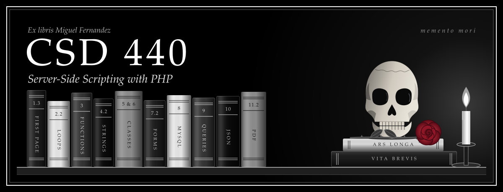

  

My coursework for **CSD 440: Server-Side Scripting**. Each folder holds one module's assignment, shelved in the order it was written. It begins with a single PHP page and works up to forms that check their input, store it in MySQL, return it as JSON and print it as a PDF.

Each volume on the banner is one module, stamped with its number and subject.

## Opening the reading room

1. Install [XAMPP](https://www.apachefriends.org/) and start **Apache**. Start **MySQL** as well if you want to read modules 8, 9 and 11.2.
2. Clone this repository into `C:\xampp\htdocs\`.
3. Open a module in your browser, for example `http://localhost/csd-440/Modules/Module_10/miguel_json_form.html`.

Modules 8, 9 and 11.2 sign in to the `baseball_01` database as `student1` / `pass`, the shared account the course provides. Module 11.2 reads the video game table from Module 8, so run Module 8's create and populate pages first.

## The stacks

### Volume I: PHP fundamentals

| Module | Folder | Open first | What it does |
|:-:|---|---|---|
| 1.2 | [`Module_1.2`](Modules/Module_1.2) | PDF | Sets up this GitHub repository |
| 1.3 | [`Module_1.3`](Modules/Module_1.3) | `FernandezFirstProgram.php` | First PHP page: prints today's date and loops through a list |
| 2.2 | [`Module_2.2`](Modules/Module_2.2) | `Migueltable2.php` | Builds a table of random numbers with nested loops |
| 3 | [`Module_3`](Modules/Module_3) | `migueltable3.php` | Fills a table with sums from a function in a separate file |
| 4.2 | [`Module_4.2`](Modules/Module_4.2) | `Miguelpalindrome.php` | Tests six strings and says which are palindromes |

### Volume II: Arrays, classes and forms

| Module | Folder | Open first | What it does |
|:-:|---|---|---|
| 5 & 6 | [`Module_5_and_6`](Modules/Module_5_and_6) | `Miguelcustomers.php` | Searches and sorts a list of customers with array functions |
| | | `Miguelmyinteger.php` | A class that stores a number and checks if it's even, odd or prime |
| 7.2 | [`Module_7.2`](Modules/Module_7.2) | `MiguelForm.html` | An employee form; PHP checks each field and lists any errors |

### Volume III: Databases and documents

| Module | Folder | Open first | What it does |
|:-:|---|---|---|
| 8 | [`Module_8`](Modules/Module_8) | `MiguelCreateTable.php` | Creates, fills, queries and drops a table of video games |
| 9 | [`Module_9`](Modules/Module_9) | `MiguelIndex.php` | Searches a pilot roster and adds new pilots through a form |
| 10 | [`Module_10`](Modules/Module_10) | `miguel_json_form.html` | Checks a customer form and returns the data as JSON |
| 11.2 | [`Module_11.2`](Modules/Module_11.2) | `MiguelPDF.php` | Prints the Module 8 video game table as a multi-page PDF with FPDF |

Each folder also keeps screenshots of its test runs.

## Examination

Every module was checked on PHP 8.2 against a live MySQL server:

- All 24 PHP files pass `php -l` with no syntax errors.
- Every page loads with HTTP 200 and no PHP warnings, notices or errors.
- The form handlers in modules 7.2 and 10 accept valid input and list a clear reason for each invalid field.
- Module 11.2 returns a valid PDF built from the database.

## Colophon

- **Author:** Miguel Fernandez, CSD 440
- **Stack:** PHP 8.2 and MySQL on XAMPP, using MySQLi with prepared statements and FPDF for the PDF
- **AI use:** [Claude Code](https://claude.com/claude-code) helped check for bugs and write comments; each file's header says so. The library banner is generated by [`assets/make_library_banner.php`](assets/make_library_banner.php).
